

### 👋 Hey there! I'm

# Vipin Kushwaha

**Software Engineer | Full-Stack Developer | MERN Stack | Industrial IoT**

I build full-stack web applications, business management systems, workflow automation tools, 
and industrial monitoring dashboards that solve real-world problems.

  

---

<table>
<tr>
<td width="50%" valign="top">

<h2>👨‍💻 About Me</h2>

I'm a software engineer focused on developing practical, maintainable, and user-friendly software solutions. My experience spans frontend development, backend APIs, database-driven applications, business workflows, and industrial automation.

<ul>
  <li>💻 Full-stack web development</li>
  <li>🔌 REST APIs and database integration</li>
  <li>🏭 Manufacturing dashboards and Industrial IoT</li>
  <li>🔐 Authentication, role-based access, and workflows</li>
</ul>

</td>
<td width="50%" valign="top">

<h2>⚙️ Tech Stack</h2>

<strong>🖥️ Frontend</strong>

  
  
  
  
  
  

<strong>🧩 Backend</strong>

  
  
  

<strong>🗄️ Databases</strong>

  
  
  
  
  

<strong>📱 Mobile</strong>

  
  
  
  

<strong>🏭 Industrial IoT</strong>

  
  
  

<strong>🛠️ Tools</strong>

  
  
  
  

<strong>🚀 Deployment</strong>

  
  
  

</td>
</tr>
</table>

## 📊 GitHub Stats

## 🚀 Featured Projects

> Project thumbnails are custom concept previews based on each repository summary; they are not screenshots of the live applications.

### 🏭 Manufacturing, Quality & Industrial Systems

<table>
<tr>
<td width="25%" valign="top">
<a href="https://github.com/CommitCraft/ukb_server_dashboard">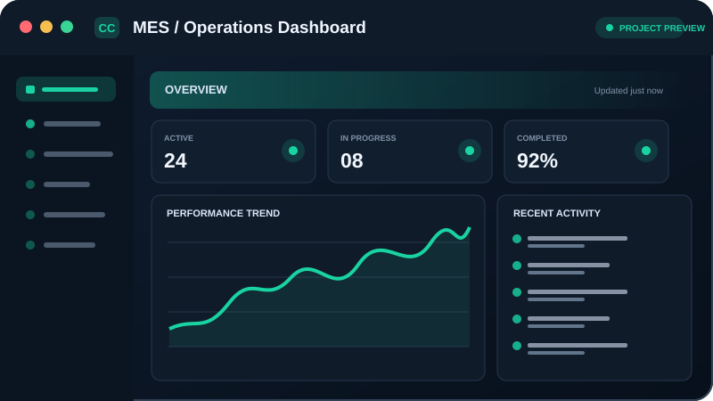</a>
<h4>1. <a href="https://github.com/CommitCraft/ukb_server_dashboard">MES / Operations Dashboard</a></h4>

A manufacturing operations dashboard for production operations, machine flows, and monitoring. It includes user permissions and integration with Node-RED.

<code>React</code> <code>Vite</code> <code>Node.js</code> <code>Express.js</code> <code>MySQL</code> <code>Node-RED</code>

<a href="https://github.com/CommitCraft/ukb_server_dashboard"><strong>View Repository →</strong></a>

</td>
<td width="25%" valign="top">
<a href="https://github.com/CommitCraft/QMS-Quality-Management-System">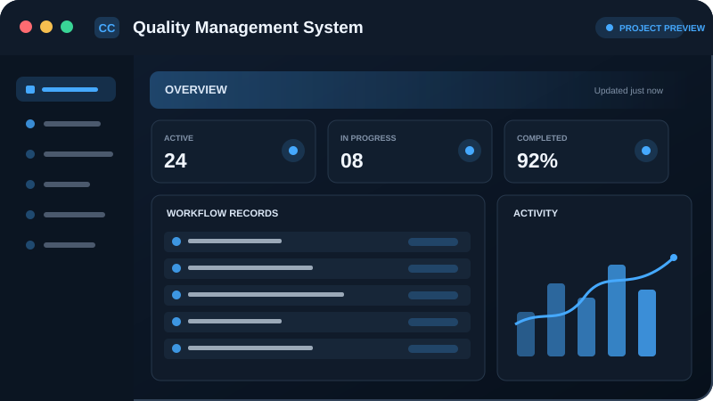</a>
<h4>2. <a href="https://github.com/CommitCraft/QMS-Quality-Management-System">Quality Management System (QMS)</a></h4>

A quality management application for maintaining quality records, managing CRUD modules, generating reports, and presenting MySQL-backed information in a dashboard.

<code>React</code> <code>TypeScript</code> <code>Node.js</code> <code>Express.js</code> <code>MySQL</code> <code>Sequelize</code>

<a href="https://github.com/CommitCraft/QMS-Quality-Management-System"><strong>View Repository →</strong></a>

</td>
<td width="25%" valign="top">
<a href="https://github.com/CommitCraft/EMS">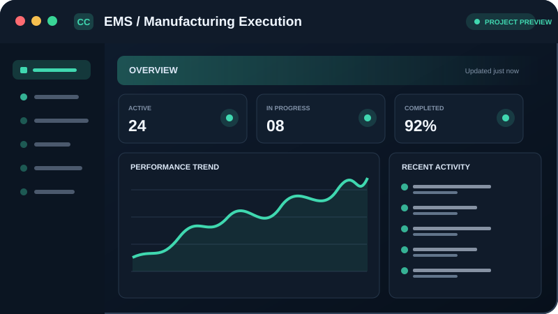</a>
<h4>3. <a href="https://github.com/CommitCraft/EMS">EMS / Manufacturing Execution System</a></h4>

A manufacturing execution system with a React and TypeScript frontend and an Express and MySQL backend.

<code>React</code> <code>TypeScript</code> <code>Express.js</code> <code>MySQL</code>

<a href="https://github.com/CommitCraft/EMS"><strong>View Repository →</strong></a>

</td>
<td width="25%" valign="top">
<a href="https://github.com/CommitCraft/Digital_CheckSheet">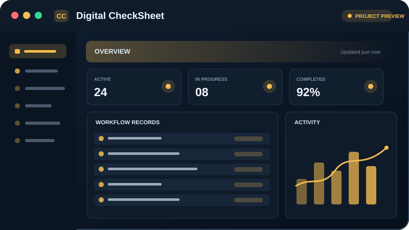</a>
<h4>4. <a href="https://github.com/CommitCraft/Digital_CheckSheet">Digital CheckSheet</a></h4>

A manufacturing inspection and digital checklist project. Refer to the repository for implementation details.

<code>Stack details in repository</code>

<a href="https://github.com/CommitCraft/Digital_CheckSheet"><strong>View Repository →</strong></a>

</td>
</tr>
<tr>
<td width="25%" valign="top">
<a href="https://github.com/CommitCraft/4M_Change_Module">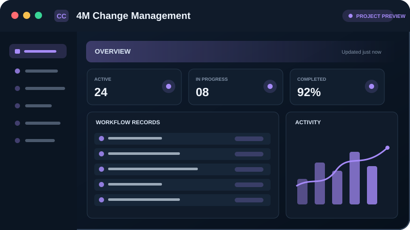</a>
<h4>5. <a href="https://github.com/CommitCraft/4M_Change_Module">4M Change Management</a></h4>

A change management application for documenting and reviewing changes involving <strong>Man, Machine, Material, and Method</strong>, with workflows to submit, review, and track changes.

<code>React</code> <code>Node.js</code> <code>Express.js</code> <code>MySQL</code> <code>Sequelize</code>

<a href="https://github.com/CommitCraft/4M_Change_Module"><strong>View Repository →</strong></a>

</td>
<td width="25%" valign="top">
<a href="https://github.com/CommitCraft/CMSCRM1">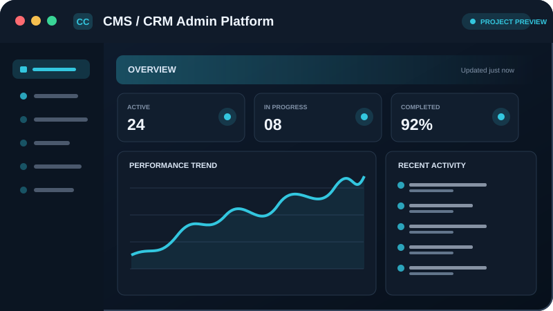</a>
<h4>6. <a href="https://github.com/CommitCraft/CMSCRM1">CMS / CRM Admin Platform</a></h4>

An administration platform for managing users and access, with activity logs, charts, and system monitoring.

<code>Stack details in repository</code>

<a href="https://github.com/CommitCraft/CMSCRM1"><strong>View Repository →</strong></a>

</td>
<td width="25%" valign="top">

<h4>7. <a href="https://github.com/CommitCraft/CRM">CRM Platform</a></h4>

A customer relationship management project. Refer to the repository for its exact modules and feature details.

<code>Stack details in repository</code>

<a href="https://github.com/CommitCraft/CRM"><strong>View Repository →</strong></a>

</td>
<td width="25%" valign="top">
<a href="https://github.com/CommitCraft/Main-Final-CRM">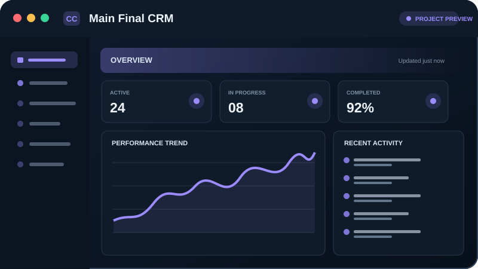</a>
<h4>8. <a href="https://github.com/CommitCraft/Main-Final-CRM">Main Final CRM</a></h4>

A CRM/CMS-style application with dashboard, permissions, and monitoring features.

<code>Stack details in repository</code>

<a href="https://github.com/CommitCraft/Main-Final-CRM"><strong>View Repository →</strong></a>

</td>
</tr>
<tr>
<td width="25%" valign="top">
<a href="https://github.com/CommitCraft/Ticket_Management">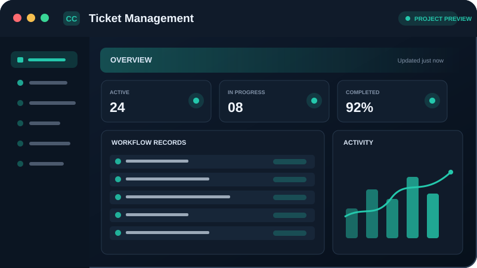</a>
<h4>9. <a href="https://github.com/CommitCraft/Ticket_Management">Ticket Management</a></h4>

A helpdesk application for handling tickets from assignment and replies through notifications and reporting.

<code>React</code> <code>Node.js</code> <code>Express.js</code> <code>MongoDB</code>

<a href="https://github.com/CommitCraft/Ticket_Management"><strong>View Repository →</strong></a>

</td>
<td width="25%" valign="top">

<h4>10. <a href="https://github.com/CommitCraft/visitor-management-system-react-main">Visitor Management System</a></h4>

A visitor management application for registration, visitor passes, role-specific access, reports, and dashboard operations.

<code>React</code> <code>Node.js</code> <code>Express.js</code> <code>MongoDB</code>

<a href="https://github.com/CommitCraft/visitor-management-system-react-main"><strong>View Repository →</strong></a>

</td>
<td width="25%" valign="top">
<a href="https://github.com/CommitCraft/Dashborad_server">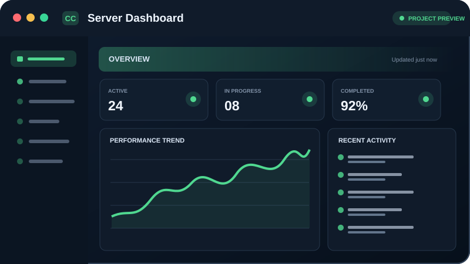</a>
<h4>11. <a href="https://github.com/CommitCraft/Dashborad_server">Server Dashboard</a></h4>

A server and operational dashboard project. Refer to the repository for verified functionality and implementation details.

<code>Stack details in repository</code>

<a href="https://github.com/CommitCraft/Dashborad_server"><strong>View Repository →</strong></a>

</td>
<td width="25%" valign="top">
<a href="https://github.com/CommitCraft/Saral-test-penal-Dashboard">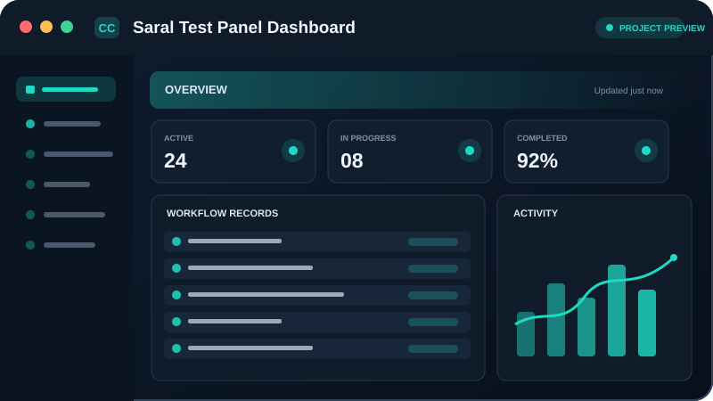</a>
<h4>12. <a href="https://github.com/CommitCraft/Saral-test-penal-Dashboard">Saral Test Panel Dashboard</a></h4>

A test application dashboard with documentation relating to log-book and shift reporting.

<code>Stack details in repository</code>

<a href="https://github.com/CommitCraft/Saral-test-penal-Dashboard"><strong>View Repository →</strong></a>

</td>
</tr>
</table>

### 💼 Business & Productivity Applications

<table>
<tr>
<td width="25%" valign="top">
<a href="https://github.com/CommitCraft/FinCore">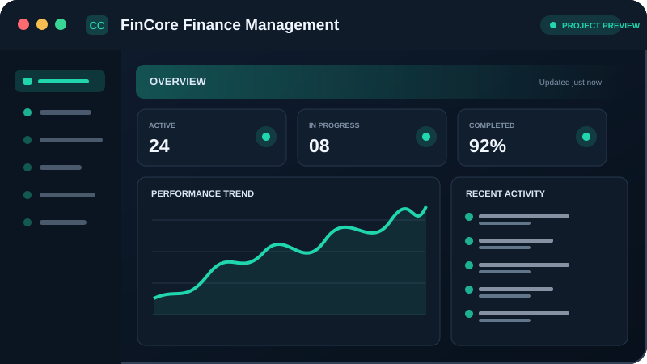</a>
<h4>13. <a href="https://github.com/CommitCraft/FinCore">FinCore Finance Management</a></h4>

A finance management application for expense reports, salary advance requests, and financial workflows with role-based access.

<code>Stack details in repository</code>

<a href="https://github.com/CommitCraft/FinCore"><strong>View Repository →</strong></a>

</td>
<td width="25%" valign="top">
<a href="https://github.com/CommitCraft/Expense-Tracker-App">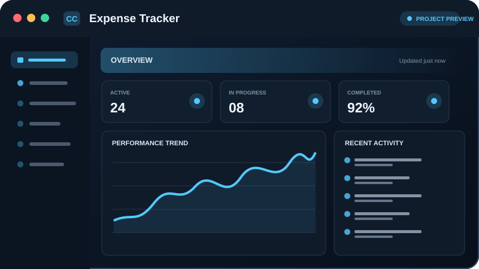</a>
<h4>14. <a href="https://github.com/CommitCraft/Expense-Tracker-App">Expense Tracker</a></h4>

A MERN application for recording income and expenses and viewing financial summaries.

<code>MongoDB</code> <code>Express.js</code> <code>React</code> <code>Node.js</code>

<a href="https://github.com/CommitCraft/Expense-Tracker-App"><strong>View Repository →</strong></a>

</td>
<td width="25%" valign="top">
<a href="https://github.com/CommitCraft/taskmanager">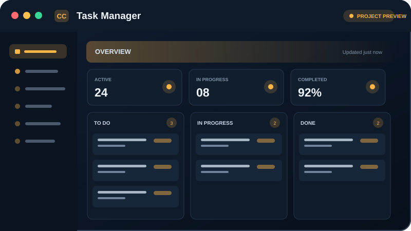</a>
<h4>15. <a href="https://github.com/CommitCraft/taskmanager">Task Manager</a></h4>

A team task management application for assigning work, organizing priorities and subtasks, and collaborating with administrative controls.

<code>Stack details in repository</code>

<a href="https://github.com/CommitCraft/taskmanager"><strong>View Repository →</strong></a>

</td>
<td width="25%" valign="top">
<a href="https://github.com/CommitCraft/Hackathon-Project">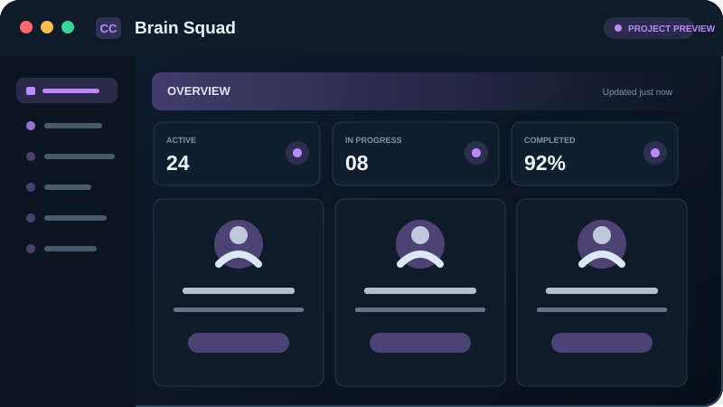</a>
<h4>16. <a href="https://github.com/CommitCraft/Hackathon-Project">Brain Squad</a></h4>

A social collaboration project combining task management with user profiles and friend requests.

<code>Stack details in repository</code>

<a href="https://github.com/CommitCraft/Hackathon-Project"><strong>View Repository →</strong></a>

</td>
</tr>
<tr>
<td width="25%" valign="top">
<a href="https://github.com/CommitCraft/google-drive">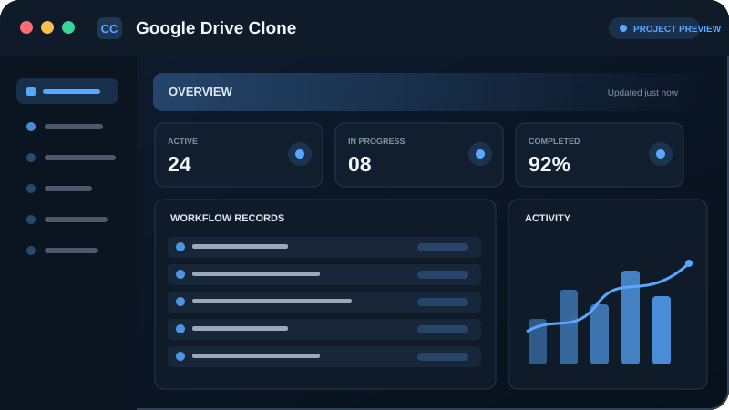</a>
<h4>17. <a href="https://github.com/CommitCraft/google-drive">Google Drive Clone</a></h4>

A file management application with upload, folder organization, deletion, and responsive file navigation.

<code>Stack details in repository</code>

<a href="https://github.com/CommitCraft/google-drive"><strong>View Repository →</strong></a>

</td>
<td width="25%" valign="top">
<a href="https://github.com/CommitCraft/JobNotifier">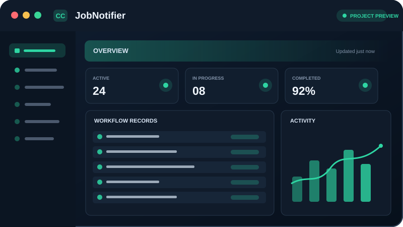</a>
<h4>18. <a href="https://github.com/CommitCraft/JobNotifier">JobNotifier</a></h4>

A job notification project that scrapes job listings and sends scheduled alerts to WhatsApp groups.

<code>Stack details in repository</code>

<a href="https://github.com/CommitCraft/JobNotifier"><strong>View Repository →</strong></a>

</td>
<td width="25%" valign="top">
<a href="https://github.com/CommitCraft/Doctor-Appointment-Web-using-MERN-Stack">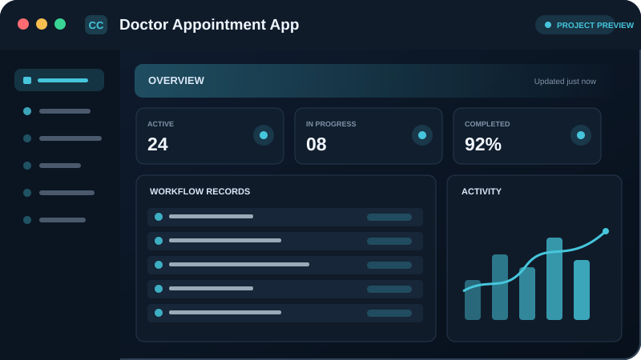</a>
<h4>19. <a href="https://github.com/CommitCraft/Doctor-Appointment-Web-using-MERN-Stack">Doctor Appointment App</a></h4>

A MERN-based doctor appointment application. Refer to the repository for its exact features.

<code>MongoDB</code> <code>Express.js</code> <code>React</code> <code>Node.js</code>

<a href="https://github.com/CommitCraft/Doctor-Appointment-Web-using-MERN-Stack"><strong>View Repository →</strong></a>

</td>
<td width="25%" valign="top">
<a href="https://github.com/CommitCraft/food_tiffin">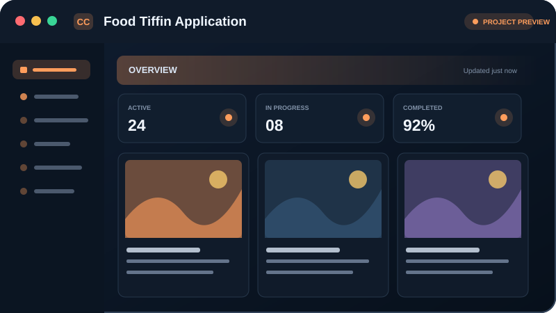</a>
<h4>20. <a href="https://github.com/CommitCraft/food_tiffin">Food Tiffin Application</a></h4>

A food-service website with a documented live demo.

<code>Stack details in repository</code>

<a href="https://github.com/CommitCraft/food_tiffin"><strong>View Repository →</strong></a>

</td>
</tr>
</table>

### 🌐 Web, Mobile & Interactive Projects

<table>
<tr>
<td width="33%" valign="top">
<a href="https://github.com/CommitCraft/Aplos-Logix-New-Website">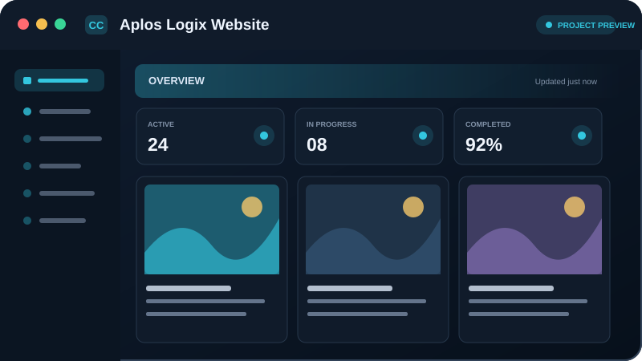</a>
<h4>21. <a href="https://github.com/CommitCraft/Aplos-Logix-New-Website">Aplos Logix Website</a></h4>

An Industrial IIoT website presenting solutions, industries, technologies, and case studies.

<code>Stack details in repository</code>

<a href="https://github.com/CommitCraft/Aplos-Logix-New-Website"><strong>View Repository →</strong></a>

</td>
<td width="33%" valign="top">
<a href="https://github.com/CommitCraft/Dashbord_Portfolio">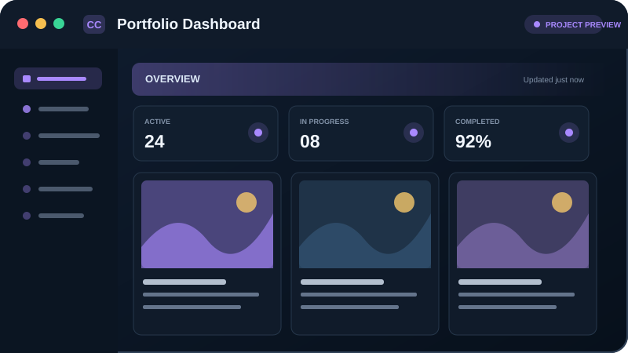</a>
<h4>22. <a href="https://github.com/CommitCraft/Dashbord_Portfolio">Portfolio Dashboard</a></h4>

A portfolio and dashboard project. Refer to the repository for its screens and features.

<code>Stack details in repository</code>

<a href="https://github.com/CommitCraft/Dashbord_Portfolio"><strong>View Repository →</strong></a>

</td>
<td width="33%" valign="top">
<a href="https://github.com/CommitCraft/ImageGallery">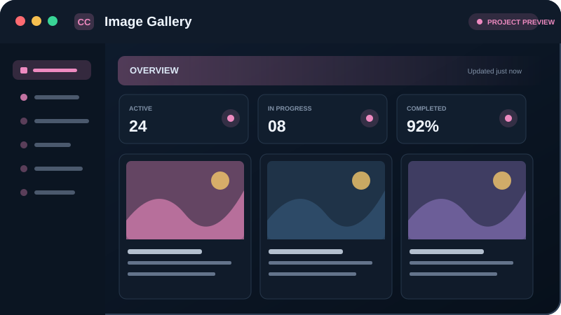</a>
<h4>23. <a href="https://github.com/CommitCraft/ImageGallery">Image Gallery</a></h4>

A React Native mobile image-gallery project.

<code>React Native</code>

<a href="https://github.com/CommitCraft/ImageGallery"><strong>View Repository →</strong></a>

</td>
</tr>
<tr>
<td width="33%" valign="top">
<a href="https://github.com/CommitCraft/Video_Player">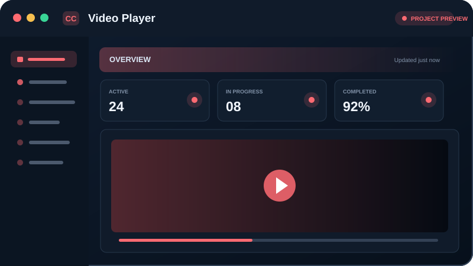</a>
<h4>24. <a href="https://github.com/CommitCraft/Video_Player">Video Player</a></h4>

An Android video-player project built with Kotlin.

<code>Kotlin</code> <code>Android</code>

<a href="https://github.com/CommitCraft/Video_Player"><strong>View Repository →</strong></a>

</td>
<td width="33%" valign="top">
<a href="https://github.com/CommitCraft/MinexNetwork">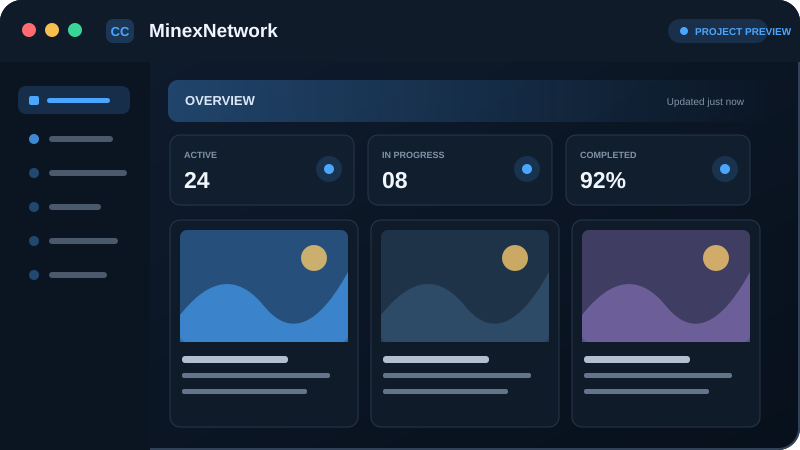</a>
<h4>25. <a href="https://github.com/CommitCraft/MinexNetwork">MinexNetwork</a></h4>

A React Native application starter repository. Refer to the repository for verified functionality.

<code>React Native</code>

<a href="https://github.com/CommitCraft/MinexNetwork"><strong>View Repository →</strong></a>

</td>
</tr>
</table>

## 🎯 Areas of Interest

`Full-Stack Development` · `Enterprise Applications` · `Industrial IoT` · `API Integration` 
`Workflow Automation` · `Database Design` · `Mobile Development` · `Scalable Architecture`

## 🤝 Let's Connect

I'm always open to collaborating on interesting projects and opportunities to build useful technology.

**Thanks for visiting my profile! ⭐**

